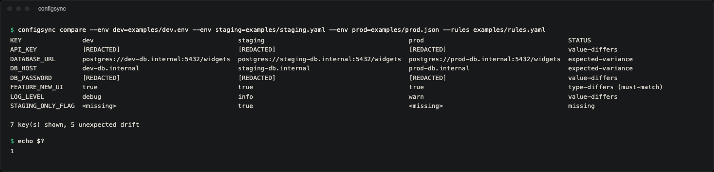
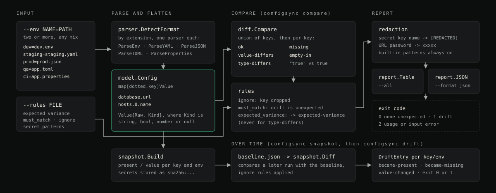

# configsync

A Go CLI that compares configuration across environments and tells you
which keys differ, which are missing and which are merely empty. Those
three have different consequences, and a plain diff shows them all as a
changed line.

`configsync` compares two or more environments (dev, staging, prod, or any
set you name) across `.env`, YAML, JSON, TOML and Java-style
`.properties` files. It flattens nested structures to dotted
paths so a YAML file and a flat `.env` file can be compared key-for-key,
classifies every difference it finds, and lets you declare which keys are
*expected* to differ (URLs, hostnames, credentials) versus which must be
identical everywhere (feature flags, timeouts).

## Demo



Real terminal capture of the comparison of the three committed example
environments (a `.env`, a YAML and a JSON file). Secrets are redacted, the
URL and host differences are expected by the rules file, and the run exits
`1` because five differences are unexpected. The same output is under
[Usage](#compare-environments) as text.

## Why

"It works in staging" is usually a config difference nobody can see.
Comparing two files by eye, or with `diff`, misses the distinction between:

- a key that's **present in both but holds a different value**,
- a key that's **missing entirely** from one environment, and
- a key that's **present but empty** in one environment.

Those are three different bugs with three different fixes, and a line-based
diff shows them all as the same kind of noise. `configsync` separates them,
adds a fourth category for type mismatches (`"true"` the string vs. `true`
the boolean is a real source of production bugs). A rules file tells it
which differences you already expect and which ones should fail a build.

## How it differs from a plain diff

| | `diff a.env b.env` | `configsync compare` |
|---|---|---|
| Formats | Same format only, line-for-line | `.env`, YAML, JSON, TOML, `.properties`, compared cross-format |
| Nesting | N/A | Nested YAML/JSON/TOML flattened to dotted paths |
| Missing vs. empty vs. different | All look like a changed line | Classified separately: `missing`, `empty-in`, `value-differs`, `type-differs` |
| Expected variance | No concept of it; every difference is noise | Rules file suppresses differences you've declared expected |
| N environments | Two files at a time | Any number of environments in one matrix |
| Secrets | Prints the full line, value included | Never prints the value of a secret-named key or a password inside a URL |
| Drift over time | No memory between runs | `snapshot` + `drift` track what changed since a saved baseline |

## Features

- **Five formats**, auto-detected by extension: `.env`, `.yaml`/`.yml`,
  `.json`, `.toml`, `.properties`.
- **Flattening**: nested maps become dotted paths (`database.host`), arrays
  become indexed paths (`hosts.0`), so structurally different formats can
  still be compared key-for-key.
- **Multi-environment matrix**: compare 2, 3, or more environments in a
  single run.
- **Five-way classification** for every key:
  - `missing`: absent in at least one environment.
  - `value-differs`: present everywhere, values differ.
  - `empty-in`: present everywhere, empty in at least one.
  - `type-differs`: present everywhere with the same string value but a
    different native type (a YAML/JSON/TOML-only distinction: `"true"` vs.
    `true`, or `"8080"` vs. `8080`).
  - `expected-variance`: differs, but matches a rule saying it should.
- **Rules file**: `expected_variance`, `must_match`, `ignore`, and
  `secret_patterns` glob lists. A `must_match` rule always wins over an
  `expected_variance` rule on the same key.
- **Secret redaction by default**: values for keys matching a secret
  pattern are never printed, in table output, JSON output or snapshots.
  Only the fact that they differ is shown.
- **Drift over time**: `snapshot` saves a point-in-time baseline; `drift`
  compares a later run against it and reports newly diverged keys, with
  secret values compared by hash so the baseline file itself is never a
  leak.
- **CI-friendly**: table or JSON output, non-zero exit code when unexpected
  drift is found.

## Formats

| Format | Extension | Notes |
|---|---|---|
| dotenv | `.env` | `KEY=value`, `export KEY=value`, single/double-quoted values with escapes, `#` comments |
| YAML | `.yaml`, `.yml` | Full nested maps and sequences, native types preserved |
| JSON | `.json` | Nested objects and arrays, native types preserved |
| TOML | `.toml` | A subset: `[table]` headers, `[[array.of.tables]]`, dotted keys, strings, booleans, decimal/hex/octal/binary integers, floats, datetimes (compared as text), single-line arrays of scalars. Inline tables, multi-line strings and multi-line arrays are rejected with an error, as are duplicate keys. |
| Java properties | `.properties` | `key=value`, `key: value`, `key value`, `\` line continuation, `#`/`!` comments, `\uXXXX` escapes |

All formats flatten to the same internal representation
(`internal/model.Config`, a `map[string]Value`), which is what makes
cross-format comparison possible: a YAML file's `database: {url: ...}` and
a `.properties` file's `database.url=...` produce the same key,
`database.url`. Key names are not otherwise normalised: an `.env` file's
`DATABASE_URL` and YAML's `database.url` are different keys and show up as
`missing` on each side, so spell keys the same way in every environment.

## Architecture



*Diagram: parse and flatten, compare and classify, apply rules, redact and report; snapshot and drift below.*

```
cmd/configsync/        CLI entry point and subcommands
internal/model/        Config, Value, Environment: the shared flattened representation
internal/parser/       One file per format, all producing model.Config
internal/rules/        Glob-pattern rule matching (expected_variance, must_match, ignore, secrets)
internal/diff/         Compare(): builds the drift matrix and classifies every key
internal/report/       Table and JSON rendering, with secret redaction
internal/snapshot/     Point-in-time snapshots and drift-since-snapshot comparison
```

The pipeline is: parse each environment file into a `model.Config` -> take
the union of keys -> classify each key against every environment's cells ->
apply rules to reclassify or escalate -> render.

## Installation

Requires Go 1.22 or newer (`go.mod`; CI tests 1.22 and 1.23 on Linux,
macOS and Windows). The only dependency is `gopkg.in/yaml.v3`.

```
go install github.com/hellpuffyt/configsync/cmd/configsync@latest
```

There are no tagged releases yet, so `@latest` resolves to the newest commit
on `main`. `configsync version` prints `configsync 0.1.0`.

Or build from source:

```
git clone https://github.com/hellpuffyt/configsync.git
cd configsync
go build -o configsync ./cmd/configsync
```

## Usage

### Compare environments

```
configsync compare \
  --env dev=examples/dev.env \
  --env staging=examples/staging.yaml \
  --env prod=examples/prod.json \
  --rules examples/rules.yaml
```

```
KEY                dev                                      staging                                      prod                                      STATUS
API_KEY            [REDACTED]                               [REDACTED]                                   [REDACTED]                                value-differs
DATABASE_URL       postgres://dev-db.internal:5432/widgets  postgres://staging-db.internal:5432/widgets  postgres://prod-db.internal:5432/widgets  expected-variance
DB_HOST            dev-db.internal                          staging-db.internal                          prod-db.internal                          expected-variance
DB_PASSWORD        [REDACTED]                               [REDACTED]                                   [REDACTED]                                value-differs
FEATURE_NEW_UI     true                                     true                                         true                                      type-differs (must-match)
LOG_LEVEL          debug                                    info                                         warn                                      value-differs
STAGING_ONLY_FLAG  <missing>                                true                                         <missing>                                 missing

7 key(s) shown, 5 unexpected drift
```

Every subcommand takes at least two `--env NAME=PATH` flags; the format of
each file is picked from its extension. By default only differences are
shown; pass `--all` to see the full matrix including matching keys (table
format only). Exit codes: `0` no unexpected drift, `1`
unexpected drift found (pass `--exit-zero` to always exit 0 for a
report-only run), `2` usage or input error (bad flags, unreadable or
unparsable files, a repeated environment name).

### JSON output

```
configsync compare --env dev=examples/dev.env --env prod=examples/prod.json --format json
```

Produces a document with `generated_at`, the `environments` list, a
`summary` (total keys, unexpected count, and a count per classification)
and an `entries` array with one object per key. Each environment's cell
carries `present`, `kind` and `value`, or `redacted: true` instead of a
`value` when the key is a secret:

```json
{
  "key": "API_KEY",
  "classification": "value-differs",
  "base_classification": "value-differs",
  "unexpected": true,
  "secret": true,
  "values": {
    "dev": { "present": true, "kind": "string", "redacted": true },
    "prod": { "present": true, "kind": "string", "redacted": true }
  }
}
```

### Save and compare against a snapshot

```
configsync snapshot --env dev=examples/dev.env --env staging=examples/staging.yaml --env prod=examples/prod.json --out baseline.json

# ... time passes, configs change ...

configsync drift --snapshot baseline.json --env dev=examples/dev.env --env staging=examples/staging.yaml --env prod=examples/prod.json
```

`drift` reports every key/environment pair whose presence or value changed
since the snapshot was taken (`became-present`, `became-missing` or
`value-changed`), except keys matched by `ignore`. After changing
`LOG_LEVEL` in `examples/dev.env`, the second command prints:

```
drift since snapshot taken at 2026-10-26 07:00:46.713825 +0000 UTC:

  dev        LOG_LEVEL                      value-changed

1 newly diverged key(s)
```

It exits `1` when anything drifted (`0` with `--exit-zero`), `0` with
`no drift detected`, and `2` on usage or input errors. `--format json`
prints the drift entries as JSON. Secret values are stored in the snapshot only
as a `sha256:...` hash, so a changed secret is detected and reported
without the snapshot file ever holding the plaintext.

## Rules file

```yaml
expected_variance:
  - "*_URL"
  - "*_HOST"
  - "*_PORT"

must_match:
  - "FEATURE_*"
  - "*_TIMEOUT_MS"

ignore:
  - "GENERATED_AT"

secret_patterns:
  - "*_DSN"
  - "*SIGNING*"
```

- Patterns use `*` as the only wildcard, matched case-insensitively against
  both a key's full dotted path and its final segment, so `*_HOST`
  matches both `DB_HOST` and `services.db.DB_HOST`. (It does not match
  `database.credentials.host`, whose last segment has no underscore; use
  `*host` for that.)
- `must_match` takes precedence over `expected_variance` when a key matches
  both: a feature flag named `FEATURE_URL_OVERRIDE` that also looks like a
  URL is still held to "must be identical everywhere."
- `expected_variance` does **not** suppress `type-differs`: a key changing
  native type across environments is treated as a real bug regardless of
  which rule it matches, because `"true"` vs. `true` is very rarely
  intentional.
- See `examples/rules.yaml` for a complete, commented example.

## Secret safety

configsync reads real configuration, potentially production configuration.
Dumping a secret value into a CI log or a snapshot file committed to a
repository would be exactly the leak this tool exists to prevent, so:

- A built-in set of secret patterns (`*PASSWORD*`, `*SECRET*`, `*TOKEN*`,
  `*_KEY`, `*CREDENTIAL*`, `*PRIVATE*`, and more) is always active, even
  with no rules file.
- A key matching any secret pattern **never** has its value printed, in
  table output, JSON output or a saved snapshot. Only whether it is
  present, and whether it differs, is recorded.
- A password embedded in a URL value (`postgres://app:PASSWORD@db/app`) is
  shown as `xxxxx` in every output even when the key name is not a secret
  pattern; snapshots keep the redacted URL plus a hash of the full value.
- Snapshots store a SHA-256 hash for secret values instead of the value
  itself, which is enough to detect that a secret changed without ever
  persisting the plaintext to disk. The hash is unsalted: a short or
  guessable secret can be recovered by hashing candidates, so treat
  snapshot files as sensitive and do not publish them.
- This is the default behavior, not an opt-in flag. Add more patterns via
  `secret_patterns` in your rules file; you cannot turn the built-in
  defaults off.

## Examples

The `examples/` directory contains a working three-environment setup:

- `dev.env`: dotenv format
- `staging.yaml`: YAML format
- `prod.json`: JSON format
- `rules.yaml`: expected-variance, must-match, ignore, and secret-pattern
  rules

Together they exercise every classification: a matching key (`APP_NAME`), a
plain unrules value difference (`LOG_LEVEL`), two expected-variance
suppressions (`DATABASE_URL`, `DB_HOST`), a must-match type violation
(`FEATURE_NEW_UI`), a missing key (`STAGING_ONLY_FLAG`), and two redacted
secret differences (`DB_PASSWORD`, `API_KEY`). Run the command under
[Usage](#usage) to see it end to end.

## Testing

```
go test ./...
```

CI also runs `go vet ./...` and `gofmt -l .`, and a smoke job that runs the
example comparison, checks that no example secret appears in the JSON
report, and round-trips a snapshot through `drift`.

The suite covers the CLI end to end on the committed examples, each format's parser (quoting, comments, nested
flattening, arrays/tables), every difference classification, rule
interactions (`expected_variance` suppressing a difference, `must_match`
escalating one even when `expected_variance` also matches), three-way and
N-way comparison, snapshot save/load/diff, and, most importantly, that a
secret value never appears in table output, JSON output or a saved snapshot
file.

## Security

configsync is a read-only comparison tool: it never writes back to your
configuration files and never transmits configuration data anywhere. The
one thing it must never do is print a secret value, which is covered above
under [Secret safety](#secret-safety) and enforced by dedicated tests. If
you find a case where a secret value leaks into output, please report it
privately at https://github.com/hellpuffyt/configsync/security/advisories/new
(see [SECURITY.md](SECURITY.md)) with a minimal reproduction using fake
values.

## Limitations

- Secret detection is by key name, plus passwords inside URLs. A secret in
  a value under an innocuous key name (for example a token pasted into
  `NOTES`) is printed.
- Key names are compared exactly after flattening; no case or separator
  normalisation between formats.
- Flattening can collide: a YAML key literally named `a.b` and a nested
  `a: {b: ...}` both become `a.b`.
- The TOML parser is a subset (see Formats) and reports what it does not
  support.

See [docs/PRODUCTION_READINESS.md](docs/PRODUCTION_READINESS.md) for the
audit evidence.

## Contributing

See [CONTRIBUTING.md](CONTRIBUTING.md) for the local gate and how to add a
format or a classification.

## License

MIT. See [LICENSE](LICENSE).
